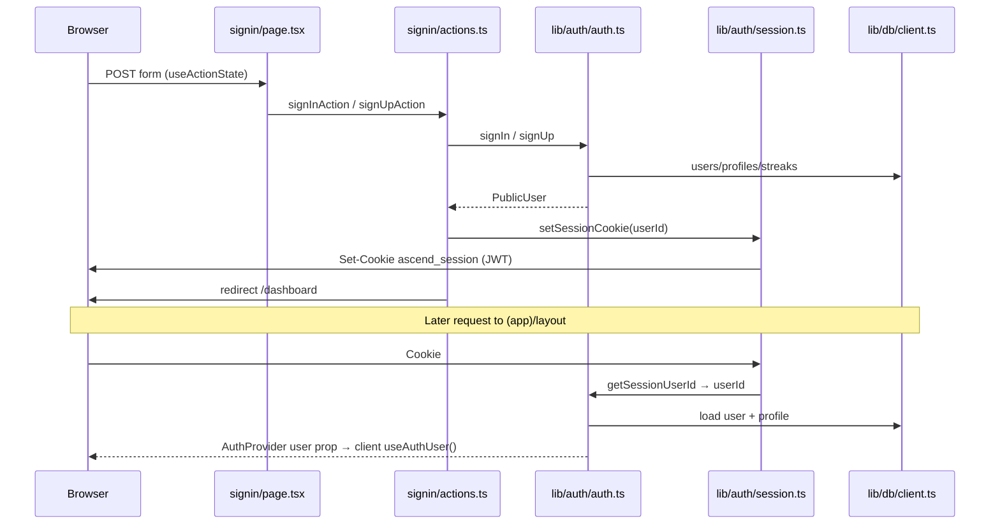
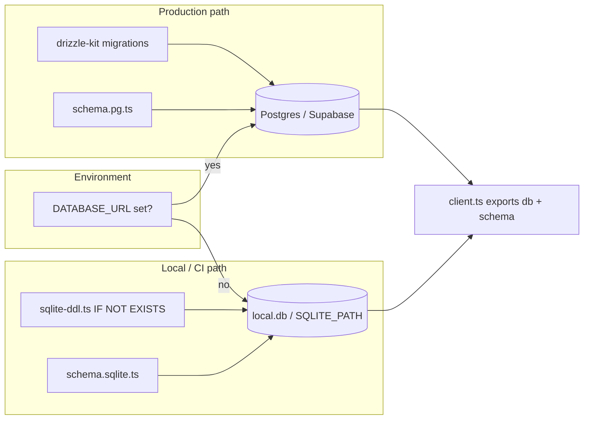
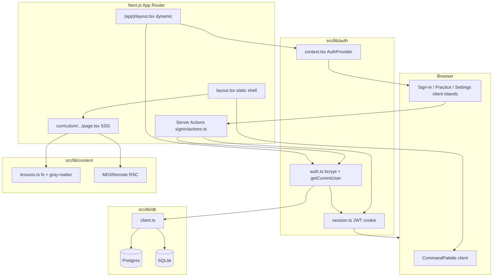

# Agent A — Architecture & Platform Report

**Role:** Architecture & Platform  
**Date:** 2026-09-22  
**Scope:** Auth, DB, layouts, config, session/cookies, content pipeline, deploy/runtime  
**Method:** Read-only inspection of cited paths (no application code changes)

---

## 1. Stack overview

| Layer | Choice | Evidence |
|-------|--------|----------|
| Framework | **Next.js 16.3.5** (App Router) | `package.json` (`next`, `eslint-config-next`) |
| UI | **React 19.2.4**, **Tailwind CSS v4** (`@tailwindcss/postcss`) | `package.json`, `src/app/globals.css`, `postcss.config.mjs` |
| Language | TypeScript 5, path alias `@/*` → `./src/*` | `tsconfig.json` |
| ORM / DB access | **Drizzle ORM 0.45.2** | `package.json`, `src/lib/db/*` |
| Postgres driver | `postgres` (postgres.js) via `drizzle-orm/postgres-js` | `src/lib/db/client.ts` |
| Local DB | **better-sqlite3** + raw DDL bootstrap | `package.json`, `src/lib/db/sqlite-ddl.ts` |
| Auth (credentials) | **Custom**: bcrypt password hashes + **JWT session cookie** (`jose` HS256) | `src/lib/auth/auth.ts`, `src/lib/auth/session.ts` |
| Auth (external) | **Not used** — no Supabase Auth, NextAuth, or OAuth implementation | README; sign-in UI stub for GitHub/Google |
| Content | **MDX** on disk: `gray-matter` + **`next-mdx-remote/rsc`** | `src/lib/content/lessons.ts`, lesson pages |
| Validation | Zod 4 | `src/lib/content/schema.ts`, auth uses inline checks |
| Build | `next build --webpack` (explicit webpack, not default bundler-only) | `package.json` scripts |

**Product shape (context):** Single Next.js app (`ascend-web`) serving marketing, 24 static lesson pages, and a signed-in “app shell” (dashboard, profile, etc.) with a dual-backend data layer for accounts only; learner progress UI still largely fixture-driven (README “What’s deferred”).

---

## 2. Request / render model

### 2.1 Layout hierarchy

```
src/app/layout.tsx          Root: fonts, globals, CommandPalette (no session)
├── Marketing / static      page.tsx, terms, privacy, onboarding, signin, reset/*, community, …
├── curriculum/page.tsx     Reads session locally + wraps AuthProvider
├── curriculum/[level]/[slug]/page.tsx   SSG (generateStaticParams), no session read
├── practice/page.tsx       Client page ("use client"), no AuthProvider
└── (app)/layout.tsx        Async RSC: getCurrentUser() → AuthProvider
    └── dashboard, profile, settings, progress, achievements, bookmarks, playground, projects/*
```

- **Root layout** (`src/app/layout.tsx`) intentionally avoids `cookies()` / `getCurrentUser()` so the homepage and lesson routes are not forced dynamic app-wide. It still runs **`getAllLessons()` at build/render** to feed the global command palette.
- **`(app)` route group** (`src/app/(app)/layout.tsx`) is the primary **session boundary**: one server fetch of the current user per request for all learner-shell pages under the group.
- **`/curriculum` index** (`src/app/curriculum/page.tsx`) is **outside `(app)`** but **also** calls `getCurrentUser()` and wraps its own `AuthProvider` — so it is dynamic for session display (sidebar/topbar) even though README groups it with “app shell” UX.

There is **no `middleware.ts`** — no edge-level auth gate or cookie rewriting.

### 2.2 Static vs dynamic (by design)

| Route class | Session read | Typical rendering |
|-------------|--------------|-------------------|
| `/`, `/curriculum/[level]/[slug]`, marketing | No | SSG / static-friendly (`generateStaticParams` on lessons) |
| `/curriculum` (index) | Yes (`getCurrentUser`) | Dynamic (`ƒ`) |
| `(app)/*` | Yes (layout) | Dynamic (`ƒ`) |
| `/signin` | Cookie **write** on success (server action) | Dynamic on POST; page is client form |
| `/practice` | No | Client-only island; sidebar shows demo user |

**Cookie read sites:**

- `src/lib/auth/session.ts` — `cookies()` for `getSessionUserId`, `setSessionCookie`, `clearSessionCookie`
- Indirectly via `getCurrentUser()` in `src/lib/auth/auth.ts` → `(app)/layout.tsx` and `curriculum/page.tsx`

**Important nuance — `AuthProvider` coverage:**

- `useAuthUser()` (`src/lib/auth/context.tsx`) is consumed by `AppSidebar` and `AppTopbar`.
- Pages under `(app)/` and `/curriculum` wrap `AuthProvider`.
- **Lesson pages and `/practice`** mount `AppSidebar` **without** `AuthProvider`, so `useAuthUser()` is always `null` and the UI falls back to demo **"Amine"** (`src/components/ui/sidebar.tsx` lines 110–111), even if the browser holds a valid session cookie.

### 2.3 RSC vs client islands

- **Server Components (default):** Homepage, lesson template (loads MDX via RSC `MDXRemote`), `(app)/layout`, most `(app)/` pages that are not marked `"use client"`.
- **Client islands (`"use client"`):** `signin`, `practice`, `onboarding`, `community`, reset flows, several `(app)/` pages (`dashboard` is RSC; `profile`, `settings`, `achievements`, `bookmarks`, `playground`, `progress` are client per grep), plus `error.tsx` / `global-error.tsx` / `not-found.tsx`.
- **Server Actions:** `src/app/signin/actions.ts` (sign-in/up + cookie + redirect), `src/lib/auth/actions.ts` (sign-out).

### 2.2 Config surface

- `next.config.ts` is **empty** (no MDX plugin at config level — MDX is runtime-compiled via `next-mdx-remote`, not `@next/mdx` page extensions despite dependency presence).
- No `dynamic`, `force-static`, or `revalidate` exports found in app code; behavior follows Next’s defaults plus `cookies()` usage.

---

## 3. Auth flow

### 3.1 Sign-up

1. Client form on `src/app/signin/page.tsx` → server action `signUpAction` (`src/app/signin/actions.ts`).
2. `signUp()` (`src/lib/auth/auth.ts`):
   - Validates email/password/name; checks duplicate email.
   - `bcrypt.hash(password, 10)`.
   - Inserts `users`, `profiles` (auto `username` via slugify + uniqueness loop), `streaks` row.
   - Returns `PublicUser` `{ id, email, name, username }`.
3. `setSessionCookie(userId, keepSignedIn)` → redirect `/dashboard`.

### 3.2 Sign-in

Same path via `signInAction` → `signIn()` (email lookup, bcrypt compare, load profile) → `setSessionCookie` → `/dashboard`.

### 3.3 Session cookie & JWT

| Item | Value |
|------|--------|
| Cookie name | `ascend_session` |
| Token | JWT (`jose`), alg **HS256**, claim `sub` = user id |
| TTL | **30 days** (`SESSION_DAYS` in `session.ts`) |
| Flags | `httpOnly`, `sameSite: lax`, `path: /`, `secure` when `NODE_ENV === production` |
| Persistence | `keepSignedIn === true` → `maxAge` 30d; else session cookie (no maxAge) — JWT still expires at 30d |

**Secret:** `process.env.AUTH_SECRET`; if unset, uses hardcoded dev default with one-time console warning (`src/lib/auth/session.ts`).

### 3.4 Resolving the current user

`getCurrentUser()` (`src/lib/auth/auth.ts`):

1. Always calls `getSessionUserId()` first (cookie → JWT verify) so Next marks the route dynamic even when DB is down.
2. Loads `users` + `profiles` from Drizzle if `db` is non-null.
3. **Never throws** to callers — failures → `null` (signed-out UX), except `DYNAMIC_SERVER_USAGE` during static probe (swallowed).

### 3.5 Sign-out

`signOutAction` (`src/lib/auth/actions.ts`): `clearSessionCookie()` → `redirect("/signin")`.

### 3.6 Authorization model

- **No route protection:** Dashboard and other `(app)` routes are reachable without a session; UI shows demo data when logged out.
- **No RBAC**, no server-side “require auth” helper beyond optional null user in components.



---

## 4. DB dual-backend story (SQLite local vs Postgres / Supabase)

### 4.1 Selection logic (`src/lib/db/client.ts`)

```
if DATABASE_URL set → postgres-js Drizzle + schema.pg.ts
else                → better-sqlite3 file + schema.sqlite.ts + SQLITE_DDL exec on open
```

- **Cached on `globalThis`** to survive dev HMR without reopening pools/files.
- **Init failures** set `db = null`, populate `dbInitError`, log server-side — **import never throws**.
- **Serverless detection:** `VERCEL`, `AWS_LAMBDA_FUNCTION_NAME`, or `NETLIFY` → default SQLite path `/tmp/local.db` instead of `cwd/local.db`.

### 4.2 Schema parity

- **Postgres canonical schema:** `src/lib/db/schema.pg.ts` (Drizzle pg tables).
- **SQLite mirror:** `src/lib/db/schema.sqlite.ts` — same tables/columns; timestamps as integer mode on SQLite.
- **Local bootstrap:** `src/lib/db/sqlite-ddl.ts` — `CREATE TABLE IF NOT EXISTS` for all tables (no drizzle-kit on SQLite path).

**Tables (both backends):** `users`, `profiles`, `streaks`, `lesson_progress`, `badges_earned`, `bookmarks`, `community_threads`, `community_replies`, `shellforge_submissions`.

**Application usage today:** Auth writes/reads `users`, `profiles`, `streaks` on signup only. **No app code** observed reading/writing progress, bookmarks, community, or shellforge tables yet (README confirms deferred).

### 4.3 Migrations (Postgres only)

- `drizzle.config.pg.ts` → schema `./src/lib/db/schema.pg.ts`, output `./drizzle/pg`.
- Scripts: `npm run db:generate`, `npm run db:migrate`.
- **No committed migration folder** in repo at audit time (`drizzle/pg` absent) — operators must generate/apply against their Supabase/Postgres instance.

### 4.4 Type erasure pattern

`db` is typed as `PostgresJsDatabase<typeof pgSchema>` even when SQLite is active; runtime uses matching dialect schema via `export const schema = ...`. Repository code is written once against Postgres-shaped types (`client.ts` comment).

### 4.5 Supabase role

Supabase is **hosted Postgres only** (`DATABASE_URL` connection string). No `@supabase/supabase-js`, no RLS integration in app code, no Supabase Auth.



---

## 5. Content pipeline (MDX lessons)

### 5.1 Source layout

- **24 lessons:** `content/curriculum/{level-id}/{slug}.mdx` (four levels under `levelIds` in `src/lib/content/schema.ts`).
- **Reference only:** `content-source/*.json`, `scripts/convert-lessons.py` (not read at runtime per README).

### 5.2 Load path

1. `src/lib/content/lessons.ts` — `fs` reads `content/curriculum`, parses frontmatter with **`gray-matter`**, validates with **`LessonFrontmatterSchema`** (Zod).
2. Exports: `getAllLessons`, `getLesson`, `getLessonNavigation`, `getAllLessonParams`.

### 5.3 Render path

- `src/app/curriculum/[level]/[slug]/page.tsx`:
  - `generateStaticParams()` → all level/slug pairs.
  - Structured sections from frontmatter (outcomes, primer, knowledge check, assignment, resources).
  - Body: **`MDXRemote`** (`next-mdx-remote/rsc`) with `remarkGfm`, `rehypeSlug`, `mdxComponents` from `src/lib/mdx-components.tsx` (`Visual`, `CodeBlock`, `TruthTable`, `CodeLab`, etc.).

### 5.4 Operational constraints (documented in README)

- MDX **expression attributes** `{...}` silently break props — project uses JSON string attributes + parse in components.
- Literal `<` in prose must be entity-escaped for MDX parser stability.

Root layout precomputes palette lesson list from `getAllLessons()` for `CommandPalette` (`src/app/layout.tsx`).

---

## 6. Deploy / runtime assumptions

| Assumption | Detail |
|------------|--------|
| **Node runtime** | Required for `better-sqlite3` native module and filesystem lesson reads |
| **Production DB** | **`DATABASE_URL` required** for durable accounts on serverless; SQLite `/tmp` is ephemeral across cold starts (`client.ts`, README) |
| **Secrets** | **`AUTH_SECRET` required** in production; default secret is insecure |
| **Build** | `npm run build` uses **webpack** bundler flag — relevant for native deps compatibility |
| **Static assets** | Lesson pages SSG; marketing/home static-friendly |
| **Env documentation** | README references `.env.example`; **file not present** in repo at audit time |
| **CI** | No `.github/workflows` observed |
| **Edge** | No middleware; auth is Node server actions + RSC |

**Default local dev:** No env → SQLite `./local.db` auto-created with DDL.

---

## 7. Security & architecture risks

| ID | Severity | Finding |
|----|----------|---------|
| R1 | **high** | **`AUTH_SECRET` fallback** to a known dev string if unset — production misconfiguration yields forgeable session JWTs (`src/lib/auth/session.ts`). |
| R2 | **high** | **No auth gate** on `(app)` routes — session is display-only; sensitive actions (settings, profile) don’t enforce login server-side. |
| R3 | **medium** | **Password policy** minimum 6 characters only (`auth.ts`); no rate limiting on sign-in/sign-up server actions. |
| R4 | **medium** | **JWT in cookie without rotation/revocation** — stolen cookie valid until expiry; no server-side session store. |
| R5 | **medium** | **Serverless + missing `DATABASE_URL`** — silent account loss on `/tmp` SQLite; users may think auth works (`client.ts`). |
| R6 | **medium** | **`better-sqlite3` on serverless** — native binary deploy friction; build explicitly uses webpack; may fail or bloat on some platforms if Postgres not configured. |
| R7 | **medium** | **Schema drift risk** — SQLite uses runtime DDL; Postgres relies on drizzle migrations **not checked in** — two paths can diverge without discipline. |
| R8 | **low** | **Session/user split on lesson routes** — valid cookie but sidebar shows demo “Amine” (missing `AuthProvider`) — UX/consistency, not direct privilege escalation. |
| R9 | **low** | **Progress/community tables** exist but unused — future features may expose data without RLS if Postgres is shared multi-tenant style. |
| R10 | **low** | **README claims `.env.example`** missing — onboarding/deploy doc gap. |
| R11 | **info** | **`@next/mdx` in dependencies** unused in `next.config.ts` — dead weight / confusion only. |

---

## 8. Architecture diagram (high level)



---

## 9. Key file index

| Concern | Path |
|---------|------|
| Orchestration goals | `docs/orchestration/00-GOALS-AND-SYSTEM.md` |
| Dependencies / scripts | `package.json` |
| Next config | `next.config.ts` |
| Root vs app layouts | `src/app/layout.tsx`, `src/app/(app)/layout.tsx` |
| Auth core | `src/lib/auth/auth.ts`, `session.ts`, `actions.ts`, `context.tsx` |
| Sign-in/up actions | `src/app/signin/actions.ts`, `src/app/signin/page.tsx` |
| DB client & schemas | `src/lib/db/client.ts`, `schema.pg.ts`, `schema.sqlite.ts`, `sqlite-ddl.ts` |
| Drizzle Postgres config | `drizzle.config.pg.ts` |
| Content loader & schema | `src/lib/content/lessons.ts`, `schema.ts` |
| Lesson render | `src/app/curriculum/[level]/[slug]/page.tsx`, `src/lib/mdx-components.tsx` |
| Session-aware curriculum index | `src/app/curriculum/page.tsx` |
| Product/backend narrative | `README.md` (Backend, Content pipeline, Deploy warnings) |

---

## 10. Summary for downstream agents

- **Real today:** Credential auth + JWT cookie + dual DB for `users`/`profiles`/`streaks`; 24 MDX lessons SSG; `(app)` and `/curriculum` index are the dynamic session surfaces.
- **Not wired:** Per-user progress, bookmarks, badges, community, shellforge persistence despite schema readiness.
- **Watch:** Deploy without `DATABASE_URL` + `AUTH_SECRET`; no middleware or route guards; lesson/practice pages ignore session in sidebar UI.

*End of Agent A report.*
