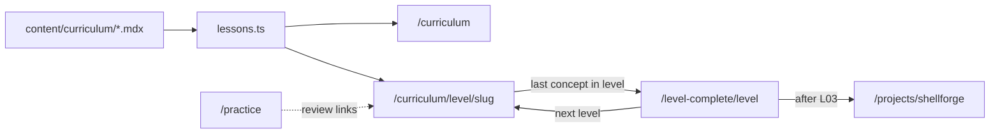

# Agent C — Curriculum & Learning

**Role:** Curriculum & Learning (Wave 2)  
**Date:** 2026-09-22  
**Scope:** `/curriculum`, `/curriculum/[level]/[slug]`, `/practice`, `/level-complete/[level]`; MDX content pipeline; lesson UI under `src/components/lesson/`  
**Method:** Read-only audit; no application code changes.  
**Context:** Wave 1 reports `01-product-objectives.md`, `02-architecture.md`.

---

## Content pipeline (how lessons load)

| Step | Behavior | Evidence |
|------|----------|----------|
| On-disk layout | `content/curriculum/{levelId}/{slug}.mdx` | `src/lib/content/lessons.ts` (`CONTENT_DIR`) |
| Discovery | Walk `levelIds` dirs; collect `*.mdx` | `listLessonRefs()` |
| Parse | `gray-matter` → Zod `LessonFrontmatterSchema` | `readLesson()` |
| Sort | By level order in `levelIds`, then `meta.order` | `getAllLessons()` |
| SSG | `generateStaticParams()` → one page per ref | `src/app/curriculum/[level]/[slug]/page.tsx` |
| Body render | RSC `MDXRemote` + `remark-gfm`, `rehype-slug` | lesson page |
| MDX components | `MemoryDiagram`, `CodeLab`, `KeyIdea`, `Visual`, `CodeBlock`, `TruthTable` | `src/lib/mdx-components.tsx` |
| Navigation | Global prev/next across levels; no “next” after last L03 lesson (Shellforge slot) | `getLessonNavigation()` comment + logic |

**Inventory:** 24 MDX files on disk (matches README). **Level metadata:** `LEVELS[].totalConcepts` sums to 25 vs 24 files — progress denominators can disagree with actual lesson count (notably Level 03: `totalConcepts: 6`, five MDX lessons).

---

## Route: `/curriculum`

**Purpose:** Curriculum hub — expandable level path, “continue” hero, fixture gamification sidebar, links into lessons.

**Key files**

| Layer | Path |
|-------|------|
| Page | `src/app/curriculum/page.tsx` |
| Panel | `src/components/curriculum/curriculum-levels-panel.tsx` |
| Shell | `AppSidebar`, `AppTopbar`, `AuthProvider` |
| Data | `getAllLessons()`, `LEVELS`, `levelIds` |

**Data source**

| UI region | Source |
|-----------|--------|
| Lesson titles, counts, links | Real MDX via `getAllLessons()` |
| “Current” lesson, `LEVEL_DONE`, hero 62%, XP/streak/badges | **Hardcoded fixtures** (`CURRENT_LEVEL`, `CURRENT_ORDER`, `LEVEL_DONE`, sidebar cards) |
| Signed-in user name in shell | Real session via `getCurrentUser()` + `AuthProvider` |
| Level lock / done / in-progress in panel | **Derived from fixture `done` counts**, not DB or completion |

**Real vs stub**

| Real | Stub / demo |
|------|-------------|
| All lesson rows and hrefs from content | Path vs **Grid** toggle (Grid label only; no handler) |
| Auth-aware topbar/sidebar when session exists | Progress, streak, concepts, badges, “Up next” anchored to fixed L02 lesson 3 |
| Filterable level accordion with lesson links | Lock rules simulated (`done === 0` locks whole level; per-lesson lock is UI-only) |

**Risks / gaps**

1. **No persisted progress** — “Pick up where you left off” always points at `what-a-pointer-really-is` (L02 order 3), not the learner’s state (`medium`).
2. **Product mismatch** — Panel shows Level 03 locked while all five L03 MDX lessons are buildable and reachable by URL (`medium`).
3. **Dual truth with auth** — Page reads real user; gamification numbers match demo “Amine” story, not `profiles` / `lesson_progress` (`medium`).
4. **25 vs 24 concepts** — `totalConcepts` drives panel percentages vs filesystem (`low`).

**Severity:** **medium** (core navigation is real; progress/lock story is misleading).

---

## Route: `/curriculum/[level]/[slug]`

**Purpose:** Primary learning surface — MDX lesson body, structured primer/outcomes, knowledge check, assignment, resources, in-lesson navigation.

**Key files**

| Layer | Path |
|-------|------|
| Page | `src/app/curriculum/[level]/[slug]/page.tsx` |
| Content API | `src/lib/content/lessons.ts`, `src/lib/content/schema.ts` |
| MDX | `src/lib/mdx-components.tsx` |
| Lesson UI | `lesson-header.tsx`, `learning-outcomes.tsx`, `primer-box.tsx`, `assignment-card.tsx`, `additional-resources.tsx`, `on-this-page-rail.tsx`, `lesson-list-panel.tsx`, `lesson-footer.tsx`, `lesson-feedback.tsx`, `add-note-button.tsx` |
| Shared | `src/components/ui/knowledge-check.tsx`, `progress-bar.tsx` |
| Interactive MDX | `code-lab.tsx`, `memory-diagram.tsx`, etc. |

**Data source**

| Section | Source |
|---------|--------|
| Title, outcomes, primer, KC, assignment, why, resources, MDX body | **Real** frontmatter + file body (Zod-validated) |
| Header progress % | `meta.order / LEVELS[level].totalConcepts` (metadata, not completion) |
| Prev/next / “Finish level” | `getLessonNavigation()` + last-in-level → `/level-complete/[level]` |
| Sidebar lesson list | Real slugs from `getAllLessons()`; **state** (done/current/locked) from **current lesson order only** (visual) |
| On-this-page rail | Primer flag + `##` headings from body + fixed KC/assignment/why ids |
| XP / streak in footer & KC banner | **Static copy** (+50 XP, 12-day streak, always-visible “Comfortable with all three?”) |

**Real vs stub**

| Real | Stub / demo |
|------|-------------|
| Full lesson content pipeline, SSG for all 24 lessons | Completion, XP, streak not recorded |
| Knowledge check Q/A + jump links to `#` anchors in lesson | Not scored; answers visible on expand (honest self-check) |
| Assignment + external resource links (where URLs exist) | No submission tracking |
| `LessonFeedback` | Client-only; downvote copy says feedback not recorded |
| `AddNoteButton` | Explicit “notes aren’t saved yet” |
| `CodeLab` in MDX | **Simulated** run (fixed snippet/output); only used in `what-a-pointer-really-is.mdx` |
| Last lesson of curriculum | Footer disabled: “end of this preview” when `next` is null |

**Lesson UI features (detailed)**

| Feature | Implementation | Real vs stub |
|---------|----------------|--------------|
| **Knowledge check** | `<KnowledgeCheck items={meta.knowledgeCheck} />` — `
` per question, answer + “Re-read” anchor via `jumpToId` | Content **real**; no validation/scoring; green “+30 XP” block always shown |
| **Code lab** | `<CodeLab />` MDX component — Run toggles fixed output + memory diagram | **Demo** only; “edit line 3” is non-functional |
| **Footer navigation** | `LessonFooter` + sticky header prev/next; last concept in level → **Finish level** → `/level-complete/[level]` | Links **real**; XP/streak text **fixture** |
| **Finish level** | `isLastInLevel = next && order === totalConcepts`; rewrites next to level-complete | **Real** routing; does not verify learner finished prior lessons |
| **Primer / assignment / resources** | Dedicated components from frontmatter | **Real** links where `url` present |
| **Lesson list panel** | Links to every lesson in level | **Locked** rows still link — no server enforcement |
| **On this page** | Scroll spy rail | **Real** structure from content |

**Risks / gaps**

1. **No AuthProvider on lesson route** — Sidebar shows demo user “Amine” even with valid session (see Agent A §2.2) (`medium`).
2. **Open curriculum** — Any slug URL works; locks on `/curriculum` and sidebar are cosmetic (`medium`).
3. **`totalConcepts` vs lesson count** — Progress bar and “Concept X of Y” can be wrong for Level 03 (`low`).
4. **KC integrity** — Relies on authors setting valid `jumpToId` matching `rehype-slug` headings; broken anchors fail silently in UX (`low`).
5. **CodeLab expectation** — Copy implies editing/running C; only one lesson includes it, behavior is canned (`low` for scope, `medium` if marketed as hands-on).

**Severity:** **medium** (content delivery is production-quality; engagement/progress layer is prototype).

---

## Route: `/practice`

**Purpose:** Duolingo-style **Pointers Drill** — timed multiple-choice quiz with hints, session stats, completion screen, links back to pointer lesson.

**Key files**

| Layer | Path |
|-------|------|
| Page | `src/app/practice/page.tsx` (`"use client"`) |
| Questions | `src/lib/practice-questions.ts` (`POINTERS_DRILL`, 11 questions) |
| Shell | `AppSidebar` (no `AuthProvider`) |

**Data source**

| Aspect | Source |
|--------|--------|
| Questions, hints, correct indices | Static TS module |
| Timer, streak, XP, phase, misses | React `useState` / `useElapsed` |
| Completion streak display “12” | **Hardcoded** on results card |
| Wrong-answer review links | All point to `what-a-pointer-really-is` |

**Real vs stub**

| Real | Stub / demo |
|------|-------------|
| Full interactive quiz UX (select, check, hint, progress dots, hearts UI) | **Single drill** only — no pull from completed lessons |
| Client-side scoring and XP formula | XP/streak **not persisted**; copy claims spaced repetition — **not implemented** |
| Hearts (3) | Visual only — misses don’t end session |
| Badge “Sharp Shooter” at ≥90% | Session-only; links to `/achievements` fixture catalog |

**Risks / gaps**

1. **Copy vs behavior** — “Practice pulls from concepts you’ve learned” / spaced repetition is aspirational (`medium`).
2. **Scope** — One topic (pointers); no routing for other drills (`low` for MVP, `medium` if practice is core loop).
3. **Same auth/sidebar gap** as lessons — demo user in sidebar (`low`).
4. **No tie-in to `lesson_progress` or KC** (`medium` alongside global progress gap).

**Severity:** **medium** (polished demo quiz; not a learning analytics surface).

---

## Route: `/level-complete/[level]`

**Purpose:** Milestone celebration after finishing a level — stats, badge flavor text, unlock next level’s first lesson or Shellforge capstone.

**Key files**

| Layer | Path |
|-------|------|
| Page | `src/app/level-complete/[level]/page.tsx` (RSC, `generateStaticParams` for four levels) |
| UI | `src/components/level-complete/level-complete-card.tsx`, `confetti.tsx` |

**Data source**

| Field | Source |
|-------|--------|
| Level name, copy, badge glyph/label | Static maps `FLAVOR`, `BADGE`, `NEXT_SUBTITLE` in page |
| `concepts` | Count of MDX lessons in level (`getAllLessons().filter`) |
| `xpEarned` | `concepts * 50` (formula, not earned) |
| Next href | First lesson of next level from content, or `/projects/shellforge` after L03 |

**Real vs stub**

| Real | Stub / demo |
|------|-------------|
| Valid level ids via `LevelIdSchema`; 404 otherwise | Page does **not** check user actually completed level |
| Next-lesson URL computed from real content order | XP/badge celebration is **presentational** |
| Share copies URL to clipboard | No server-side share/proof |

**Risks / gaps**

1. **Gating** — Reachable directly via URL without completing last lesson (`medium`).
2. **Level 03 → Shellforge** — Correct product bridge; last L03 lesson footer still says “preview end” while level-complete offers capstone — slightly inconsistent end-of-path messaging (`low`).
3. **No persistence** — Completing level doesn’t write badges/XP (`medium`, shared platform gap).

**Severity:** **low–medium** (celebration UX is real; milestone is not authenticated or stored).

---

## Cross-cutting: curriculum domain summary

Ascend’s **learning core is real and file-based**: 24 validated MDX lessons, SSG lesson pages, rich MDX components, and coherent cross-level navigation ending in level-complete → next level or Shellforge. The **engagement layer on these routes is still the static prototype**: fixed “current lesson,” fixture XP/streak/badges, non-persistent practice, simulated CodeLab, and UI locks that do not restrict URLs.

Wave 1 alignment:

- **G2 (architecture):** Content pipeline is clear (`lessons.ts` + `next-mdx-remote/rsc`); session boundary skips lesson/practice pages.
- **G3 (inventory):** Four owned routes documented above.
- **G4 (gaps):** Progress persistence and honest gating are the main curriculum-domain debts.

---

## Top risks (Curriculum & Learning domain)

| # | Risk | Severity | Notes |
|---|------|----------|-------|
| 1 | **No `lesson_progress` (or local) wiring** — continue hero, locks, footer XP, level-complete are fiction | **high** | Undermines “progress saves” messaging; tables exist unused (Agent P) |
| 2 | **Lesson/practice routes outside `AuthProvider`** — signed-in learners see demo sidebar identity | **medium** | `02-architecture.md` §2.2 |
| 3 | **Curriculum locks are UI-only** — deep links bypass path gating | **medium** | Index panel vs `lesson-list-panel` links |
| 4 | **Practice marketed as adaptive; single static drill** | **medium** | `practice-questions.ts` only |
| 5 | **`totalConcepts` (25) vs 24 MDX lessons** — misleading progress denominators | **low** | Especially Level 03 |
| 6 | **CodeLab / KC XP banners imply earned rewards without checks** | **low** | UX honesty for self-paced OSS preview |

---

*End of Agent C report. Input for Wave 3 synthesis (`99-MASTER-PROJECT-REPORT.md`).*
