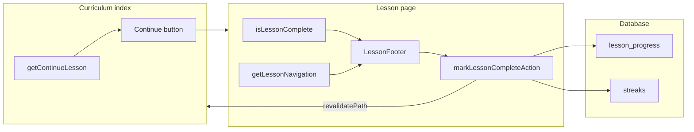

# Learning loop (LEARN)

**Agent:** LEARN  
**Date:** 2026-09-22  
**Scope:** Signed-in curriculum continue → lesson → mark complete → navigation; open-path URL access; `/practice` identity and persistence.  
**Method:** Read-only code trace (no app changes). Assumes **A+Open**: curriculum content is reachable without locks; **progress requires sign-in + DB**.

---

## Summary matrix

| Journey | Status | Notes |
|---------|--------|-------|
| J1 — Curriculum **Continue** → lesson (signed in) | **Pass** | `getContinueLesson` drives hero CTA href |
| J2 — **Mark complete** → `lesson_progress` → UI state | **Pass** | Server action + local `Saved`; revalidate on nav |
| J3 — **Continue / Next** across lessons; L03 end → Shellforge | **Pass** | Nav from `getLessonNavigation`; capstone labeled on level-complete |
| J4 — **Open path** — deep-link “Recommended later” lesson | **Pass** | No route guard; MDX renders |
| J5 — **`/practice`** + `AuthProvider`; save progress | **Gap** | Identity in sidebar **Pass**; drill results **not persisted** |

---

## Shared progress spine

| Layer | Role |
|-------|------|
| `src/lib/progress/queries.ts` | Read/write `lesson_progress`, `getContinueLesson`, `isLessonComplete`, streak bump on complete |
| `src/lib/progress/actions.ts` | `markLessonCompleteAction` — auth gate, DB write, `revalidatePath` |
| `src/lib/content/lessons.ts` | `getLesson`, `getAllLessons`, `getLessonNavigation` (cross-level prev/next) |

**Continue pointer:** `getContinueLesson(userId)` loads completions, walks `getAllLessons()` in order, returns the first lesson not in the done set; if all complete, returns the **last** lesson (`queries.ts` L70–85).

**Mark complete:** Inserts into `lesson_progress` if missing, then `bumpStreak` (`queries.ts` L107–133). Idempotent for the same lesson.

**Server action:** Requires `getCurrentUser()`; otherwise `{ ok: false, error: "Sign in to save lesson progress." }` (`actions.ts` L16–32). On success revalidates `/dashboard`, `/curriculum`, the lesson path, and `/progress`.

---

## J1 — Signed-in: `/curriculum` Continue CTA → lesson

**Intent:** Resume at the learner’s next incomplete concept from the curriculum index.

**Steps**

1. User opens `/curriculum` (layout loads session — `src/app/curriculum/layout.tsx`).
2. Server calls `getCurrentUser()`; if present, `getContinueLesson(user.id)` and per-level `countCompletedInLevel` (`src/app/curriculum/page.tsx` L36–47).
3. Hero card uses `current` = lesson at continue level/order; primary button links to `/curriculum/{level}/{slug}` (`page.tsx` L109–133).
4. Signed-in label is **Continue** (unsigned: **Start**, fallback L00 order 1 — `page.tsx` L18–19, L127–128).

**Entry:** `/curriculum` (authenticated session).  
**Exit:** Lesson route `/curriculum/[level]/[slug]`.

**Code path**

- `src/app/curriculum/page.tsx` — continue hero + `CurriculumLevelsPanel` props  
- `src/lib/progress/queries.ts` — `getContinueLesson`, `countCompletedInLevel`  
- `src/app/curriculum/layout.tsx` — `AuthProvider` for sidebar/topbar identity  

**Status:** **Pass** (when DB available; errors fall back to open-path defaults — `page.tsx` L45–47).

**Honesty notes**

- Sidebar “Your progress” on the same page (Lv 8, 560 XP, streak 12, 19/25 concepts) is **static fixture**, not wired to `queries.ts` (`page.tsx` L151–205). **Gap (medium)** — does not affect the Continue CTA itself.
- Level panel “done” styling uses continue order + level completion counts, not per-lesson completion rows for every row (`curriculum-levels-panel.tsx` L167–170).

---

## J2 — Lesson: Mark complete → `lesson_progress` → reload state

**Intent:** Persist completion for the signed-in user and reflect it in the lesson footer (and eventually index/dashboard).

**Steps**

1. Lesson page server-loads `initiallyComplete` via `isLessonComplete(user.id, level, slug)` and optional `getStreak` (`src/app/curriculum/[level]/[slug]/page.tsx` L80–91).
2. `LessonFooter` receives `signedIn`, `initiallyComplete`, `streakDays` (`page.tsx` L245–252).
3. User clicks **Mark complete** → client `markLessonCompleteAction(level, slug)` (`src/components/lesson/lesson-footer.tsx` L28–41).
4. On `ok`, footer sets local `complete` → **Saved** badge (`lesson-footer.tsx` L58–59); no full-page reload.
5. Next request to revalidated routes sees updated DB state (`actions.ts` L24–27).

**Entry:** Any lesson URL.  
**Exit:** Same page (footer updated) or follow **Next** CTA.

**Code path**

- `src/app/curriculum/[level]/[slug]/page.tsx` — load completion + render footer  
- `src/components/lesson/lesson-footer.tsx` — CTA + `useTransition`  
- `src/lib/progress/actions.ts` — `markLessonCompleteAction`  
- `src/lib/progress/queries.ts` — `isLessonComplete`, `markLessonComplete`  

**Status:** **Pass** for persist + footer feedback.

**Honesty notes**

- Anonymous users see **Sign in to save progress**; click path sets error if they somehow trigger mark (`lesson-footer.tsx` L29–31, L69–72). **Pass** (aligned with A+Open).
- **Streak in footer** comes from server props at render; after mark complete, streak may increase in DB but footer streak text **does not refresh** until navigation/full reload (no `router.refresh()`). **Gap (low)**.
- Knowledge check “Ready” banner is **cosmetic** (always shown) — not gated on answers (`page.tsx` L208–219). Out of progress spine but visible on the loop.

---

## J3 — Continue / next navigation; end of L03 → Shellforge

**Intent:** Move forward through the curriculum; finish a level via level-complete; after final lesson, hand off to Shellforge demo.

**Navigation rules** (`src/lib/content/lessons.ts` L67–88)

- `getLessonNavigation(level, order)` returns prev/next **across levels** (last lesson of L00 → first of L01).
- At curriculum end, `next` is `null`; Shellforge is the documented next step (comment L71–72).

**Lesson page wiring** (`src/app/curriculum/[level]/[slug]/page.tsx`)

| Case | Sticky header “Next” | Footer primary CTA |
|------|----------------------|-------------------|
| Mid-level | `next.href` → next lesson title | `Next: {title}` or `Finish level` |
| Last concept in level (not final lesson of L03) | **Finish level** → `/level-complete/{level}` | Same (`L58–62`, `L144–154`) |
| Last lesson overall (L03 order 5: `file-descriptors-and-redirection`) | No next button (`nextNav` null) | **Shellforge project** → `/projects/shellforge` (`L93–95`, `L245–249`) |

**Curriculum index**

- **Up next** and level panel **Continue / Start / Open / Review** links all point at real lesson hrefs (`page.tsx` L214–237; `curriculum-levels-panel.tsx` L220–248).

**Level complete (after “Finish level”)**

- `src/app/level-complete/[level]/page.tsx` — for L03, unlock block points to `/projects/shellforge` with copy **“Open Shellforge (demo)”** and subtitle **“Demo capstone flow — no real clone or auto-grader yet”** (L64–71). **Pass** for honest capstone labeling.

**Status:** **Pass**.

**Honesty notes**

- Footer fallback button **Continue to Shellforge** when `next` is null (`lesson-footer.tsx` L90–93) duplicates the explicit `footerNext` Shellforge link on the last lesson — consistent destination.
- `LessonListPanel` on the lesson page marks **current** by `meta.order` of the page being viewed, not by `getContinueLesson` — correct for open path; checkmarks are positional within the level, not DB-backed (`lesson-list-panel.tsx` L42–43).

---

## J4 — Open path: URL to a “Recommended later” lesson

**Intent:** A+Open — learner can read any lesson without completing prior levels.

**Steps**

1. Curriculum UI labels non-current levels **Recommended later** and shows **Open path — recommended after earlier levels** (`curriculum-levels-panel.tsx` L122–125, L157–158).
2. Each upcoming lesson still renders an **Open** link to `/curriculum/{level}/{slug}` (L243–248).
3. Lesson route: `getLesson(level, slug)` or `notFound()` — **no** auth middleware, **no** completion check (`page.tsx` L50–52).
4. `generateStaticParams()` exposes all lesson params (`page.tsx` L28–30).

**Entry:** Direct URL or panel **Open**.  
**Exit:** Read content; optional mark complete if signed in.

**Status:** **Pass**.

**Honesty notes**

- UI discourages skipping via labels; behavior allows it — **Pass** for A+Open honesty spine.

---

## J5 — `/practice` with `AuthProvider`; does practice save progress?

**Intent:** Practice drill with correct chrome identity; optional persistence of quiz results.

**Steps**

1. `src/app/practice/layout.tsx` — server `getCurrentUser()` → `AuthProvider user={user}` (comment: sidebar shows real user).
2. `src/app/practice/page.tsx` — **client-only** quiz over `POINTERS_DRILL`; state in React (`useState` for answers, streak, phase).
3. `AppSidebar` uses `useAuthUser()` from context (same as curriculum via `src/components/ui/sidebar.tsx`).

**Persistence**

- No imports from `@/lib/progress/actions` or `queries` on practice routes.
- No server actions or API calls on completion; XP/streak on results screen are **computed locally** (e.g. `xp` L50; hardcoded **12** day streak on complete L179).

**Entry:** `/practice` (sidebar, dashboard links, command palette).  
**Exit:** Dashboard link or restart.

**Code path**

- `src/app/practice/layout.tsx`  
- `src/app/practice/page.tsx`  
- `src/lib/auth/context.tsx` — `AuthProvider`, `useAuthUser`  

**Status**

- Identity in shell: **Pass** (matches curriculum pattern).
- Save drill progress / XP / badges: **Gap** — copy claims spaced repetition and learning-linked drills (`page.tsx` L512–515) but content is a **fixed** pointer drill file.

**Honesty notes**

- **Gap (high):** “Practice pulls from concepts you’ve learned” / “Miss one and it’ll resurface later” — not implemented; no DB.
- **Gap (medium):** Results screen “12 day streak” and badge earn UI are not tied to `getStreak` or achievements backend.
- **Gap (low):** `/progress` activity feed includes a fixture row pointing at `/practice` (`src/app/(app)/progress/page.tsx` L30) — not written by practice completion.

---

## Cross-journey dependencies

---

## File index (LEARN)

| File | Use in flows |
|------|----------------|
| `src/lib/progress/queries.ts` | Completions, continue, mark complete, streak |
| `src/lib/progress/actions.ts` | `markLessonCompleteAction`, revalidation |
| `src/lib/progress/types.ts` | `ContinueLesson`, `LessonCompletion` |
| `src/app/curriculum/page.tsx` | Continue CTA, level done counts |
| `src/app/curriculum/[level]/[slug]/page.tsx` | Lesson shell, nav, footer props |
| `src/app/curriculum/layout.tsx` | Session + `AuthProvider` |
| `src/components/lesson/lesson-footer.tsx` | Mark complete + next CTA |
| `src/components/curriculum/curriculum-levels-panel.tsx` | Open path links, Recommended later |
| `src/lib/content/lessons.ts` | Content + navigation |
| `src/app/level-complete/[level]/page.tsx` | L03 → Shellforge demo handoff |
| `src/app/practice/layout.tsx` | Practice session boundary |
| `src/app/practice/page.tsx` | Client drill (no progress save) |

---

## Recommended follow-ups (orchestration only)

1. Wire curriculum sidebar XP/streak/concept counts to `listCompletedLessons` / `getStreak` (or demote to placeholder labeling).
2. Practice: either persist sessions server-side or soften copy to match static drill.
3. Optional `router.refresh()` after mark complete to sync streak in footer without full navigation.
