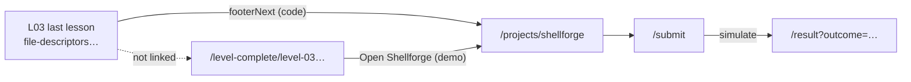

# CAP — Capstone handoff (Level 03 → Shellforge)

**Agent:** CAP (Wave 2)  
**Date:** 2026-09-22  
**Method:** Read-only code trace (no app edits)  
**Assumption:** A+Open — curriculum URLs load without lock enforcement; progress save requires sign-in.

## Journey intent

After systems lessons, the learner should discover **Shellforge** (build a shell in C), understand it is a **labeled demo** until a real grader exists, walk through brief → submit → pass/fail result, and exit with honest expectations about XP, peers, and persistence.

---

## 1. Last L03 lesson → footer / header → Shellforge

### Steps

1. Open the final Level 03 MDX lesson: **`file-descriptors-and-redirection`** (frontmatter `order: 5`).
2. Sticky header prev/next: **Previous** works; **Next / Finish level** is **absent** (no `nextNav` when there is no following lesson).
3. Footer gradient card: primary CTA is **`Shellforge project`** → `/projects/shellforge` (via `footerNext`, not `level-complete`).
4. Sidebar (`LessonListPanel`): copy links **Shellforge (demo project flow)** when there is no next level name.

### Entry / exit

| | |
|---|---|
| **Entry** | `/curriculum/level-03-systems-software/file-descriptors-and-redirection` (or any path that ends at curriculum tail) |
| **Exit** | `/projects/shellforge` (brief) |

### Code path

| Concern | File | Behavior |
|---------|------|----------|
| Global prev/next ends at last lesson | `src/lib/content/lessons.ts` | `getLessonNavigation` returns `next: null` after the last sorted lesson; comment names Shellforge as the successor, not a route. |
| Footer injects Shellforge at curriculum end | `src/app/curriculum/[level]/[slug]/page.tsx` | `endOfCurriculum = next === null` → `footerNext = { href: "/projects/shellforge", title: "Shellforge project" }`. |
| `Finish level` only when another lesson exists | Same page | `isLastInLevel = next !== null && meta.order === levelInfo.totalConcepts` → on L03 lesson 5, `next` is null, so **never** `/level-complete/level-03-systems-software` from this page. |
| Footer button label | `src/components/lesson/lesson-footer.tsx` | Titles starting with `Shellforge` render verbatim (not `Next: …`). |
| Sidebar handoff | `src/components/lesson/lesson-list-panel.tsx` | When `nextLevelName` is null (L03), Shellforge link + “demo project flow”. |

### Status

| Step | Status | Notes |
|------|--------|-------|
| Footer → Shellforge on last lesson | **Pass** | Wired in lesson page. |
| Header next on last L03 lesson | **Gap** | No sticky “Next”; only footer promotes capstone (easy to miss). |
| L03 → `level-complete` from lesson flow | **Gap** | Unlike L00–L02, L03 last lesson **skips** level-complete celebration; `/level-complete/level-03-systems-software` is only reachable by direct URL or indirect discovery. |
| L03 concept count vs files | **Gap** | `LEVELS["level-03-systems-software"].totalConcepts` is **6** (`schema.ts`) but only **5** MDX lessons exist — UI shows “Concept X of 6”. |

### Honesty notes

- Sidebar explicitly says **demo project flow** (**Pass**).
- Footer does **not** say “demo” on the CTA label (**low** — brief page carries `CAPSTONE · DEMO`).

---

## 2. `/level-complete/level-03-systems-software` → Shellforge CTA

### Steps

1. Navigate to `/level-complete/level-03-systems-software` (static param from `levelIds`).
2. Card shows level stats, badge flavor, confetti UI.
3. Unlock block uses capstone branch (no `nextLevelId`): CTA **`Open Shellforge (demo)`** → `/projects/shellforge`.
4. Subtitle: **“Demo capstone flow — no real clone or auto-grader yet”**; pill **`CAPSTONE (DEMO)`**.

### Entry / exit

| | |
|---|---|
| **Entry** | Manual/deep link (not emitted from last L03 lesson footer today) |
| **Exit** | `/projects/shellforge` |

### Code path

- `src/app/level-complete/[level]/page.tsx` — `unlock` ternary when `nextLevelId` is missing; L03 labels and href.
- `src/components/level-complete/level-complete-card.tsx` — presents `nextHref` / `nextLabel` / `unlockLabel`.

### Status

| Step | Status | Notes |
|------|--------|-------|
| Demo labeling on level-complete | **Pass** | Label + subtitle + `CAPSTONE (DEMO)` unlock pill. |
| Level-complete in L03 happy path | **Gap** | Lesson chain goes **lesson 5 → Shellforge**, not **lesson 5 → level-complete → Shellforge**. |

### Honesty notes

- Strongest demo disclosure in the product for this journey (**Pass**).

---

## 3. Shellforge brief → submit → result (simulate pass / fail)

### Steps

1. **`/projects/shellforge`** — Hero badge **`CAPSTONE · DEMO`**; brief component with requirements checklist, milestones, peer teaser (blurred), sticky panel **Start project** → submit.
2. **`/projects/shellforge/submit`** — Paste repo URL (any non-empty string); info box states **demo preview — no real auto-grader**; choose **Simulate: all checks pass** or **Simulate: needs fixes**.
3. **`/projects/shellforge/result?outcome=passed|failed`** — Static test matrices; pass shows peer gallery + fixture XP/badge; fail shows fix hints + resubmit.

### Entry / exit

| | |
|---|---|
| **Entry** | Lesson footer, level-complete, ⌘K (`command-palette.tsx`), profile project card, sidebar on L03 |
| **Exit (pass)** | Achievements link, community, re-submit, peer section |
| **Exit (fail)** | Resubmit, pipes lesson review, community |

### Code path

| Route | Key files |
|-------|-----------|
| Brief | `src/app/(app)/projects/shellforge/page.tsx`, `src/components/projects/shellforge-brief.tsx` |
| Submit | `src/app/(app)/projects/shellforge/submit/page.tsx` |
| Result | `src/app/(app)/projects/shellforge/result/page.tsx`, `src/components/projects/peer-solutions.tsx` |

### Simulation mechanics

- Submit buttons call `router.push("/projects/shellforge/result?outcome=passed|failed")` — **no server action**, no clone, no use of `shellforge_submissions` (schema/DDL only).
- Result: `passed = outcome !== "failed"` — **missing or any other query value defaults to pass** (URL can “force” pass without submit).
- Pass/fail narratives are **fixed** `PASSED_GROUPS` / `FAILED_GROUPS`; submitted URL is **ignored** (sidebar always `github.com/you/shellforge`).

### Status

| Step | Status | Notes |
|------|--------|-------|
| Brief reachable & structured | **Pass** | Full capstone UX surface. |
| Submit honesty callout | **Pass** | Explicit demo + simulate buttons. |
| Result pedagogy (fail notes) | **Pass** | Useful static teaching copy. |
| Real grader / DB persistence | **Gap** | By design stub; table unused. |
| Default pass on `/result` without `outcome=failed` | **Gap** | Command palette links `?outcome=passed` — convenient demo, weak integrity. |
| Submit chrome | **Gap** | Full-screen card only — no `AppSidebar` / `AppTopbar` (brief/result have them). |

### Honesty notes (labels vs behavior)

| Copy | Honest? | Severity |
|------|---------|----------|
| Brief requirements: “self-tracked … doesn’t verify or grade” | **Yes** | — |
| Clone starter: “demo preview — no real starter repo” | **Yes** | — |
| Submit: “demo preview — no real auto-grader” + simulate buttons | **Yes** | — |
| Brief sidebar: “auto-checked in ~30s” | **No** | **medium** — contradicts submit/clone honesty |
| Brief hero: `COMPLETED 2,140`, `+800 XP` reward | **No** | **low** — marketing fixtures |
| Peer teaser: “Submit to unlock” / “Pass the project first” | **Partial** | **low** — unlock is simulated pass, not real grade |
| Result fail hero: “your progress is saved” | **No** | **medium** — no submission persistence |
| Result pass: `+800 XP`, badge, “2,600 XP total · Level 8” | **No** | **medium** — not wired to progress engine |
| Result “Build output” / commit hashes / dates | **No** | **low** — labeled fiction only if learner already read submit disclaimer |
| Peer “Read code” (peer-solutions) | **N/A** | **low** — no href; decorative |

---

## 4. Cross-cutting gaps (curriculum continuity & product)

| Gap | Severity | Evidence |
|-----|----------|----------|
| **No real grader** | **high** (product) | Submit simulates; result static; `shellforge_submissions` unused |
| **L03 skips level-complete** | **medium** (UX) | `next === null` on last lesson bypasses `Finish level` / celebration |
| **Navigation comment vs wiring** | **low** | `lessons.ts` documents Shellforge; only lesson **page** adds href |
| **Alternate discovery only** | **medium** | ⌘K, profile fixture card, manual level-complete URL |
| **5 lessons vs 6 concepts** | **medium** (content) | `totalConcepts: 6` in `schema.ts` vs five MDX files |
| **No lock/completion guard on Shellforge** | **low** (A+Open) | Any signed-in or anonymous user can open full demo flow |

---

## Summary matrix (CAP scope)

| Journey segment | Status | One-line verdict |
|-----------------|--------|------------------|
| Last L03 lesson → Shellforge footer | **Pass** | Linked; demo hint in sidebar only |
| L03 level-complete → Shellforge | **Pass** (labeling) / **Gap** (discovery) | Best demo labels; rarely hit from lessons |
| Brief → submit → simulate result | **Pass** (UX + submit honesty) / **Gap** (backend) | Teaching UI real; grading fictional |
| Honesty spine overall | **Mixed** | Submit/brief checklist strong; brief timing/stats, result XP/saved copy weak |

---

## Related reports

- `docs/orchestration/agent-reports/06-pages-projects.md` — Shellforge route deep dive  
- `docs/orchestration/agent-reports/04-pages-curriculum.md` — lesson navigation & level-complete  
- `docs/orchestration/fix-program/99-VERIFICATION.md` — acceptance #8 (link + demo badge)
