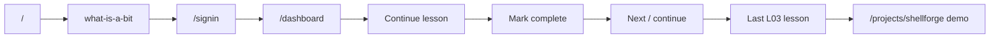

# User-Flow Master Report

**Date:** 2026-09-22  
**Orchestration:** `00-FLOW-ORCHESTRATION.md`  
**Sources:** Agents ANON, AUTH, LEARN, APP, CAP (`01`–`05`)

---

## Verdict

**Core learning loop works for signed-in users:** land → start lesson → mark complete → continue/dashboard resume.  
**Auth signup/signin works.** Reset is correctly demoted.  
**Remaining honesty debt** is mostly *chrome and side surfaces*: Amine/demo XP for anonymous shell, fixture profile/progress/achievements, practice not saving, Shellforge still a labeled simulator.

---

## Journey map (happy path)

---

## Flow status matrix

| Journey | Agent | Status | One-line |
|---------|-------|--------|----------|
| Home → first lesson | ANON | **Pass** | CTAs → `what-is-a-bit` |
| Browse signed out | ANON | **Pass** + Gap | Open path OK; Amine/fake XP chrome |
| Mark complete signed out | ANON | **Pass** | Prompt to sign in; no fake save |
| Sign-up / sign-in | AUTH | **Pass** | Real DB + cookie → `/dashboard` |
| Sign-out | AUTH | **Pass** | From profile |
| OAuth | AUTH | **Gap** | Buttons notify only |
| Password reset | AUTH | **Gap** (safe) | Stub; no password change; → signin |
| Curriculum continue (authed) | LEARN | **Pass** | `getContinueLesson` |
| Mark complete persist | LEARN | **Pass** | `lesson_progress` + Saved UI |
| Open-path deep links | LEARN | **Pass** | No gate |
| Practice | LEARN | **Gap** | Auth OK; quiz not persisted |
| Dashboard resume | APP | **Pass** | Real name + continue |
| Settings save | APP | **Pass** | Profile DB round-trip |
| Profile page | APP | **Broken** (honesty) | Name real; stats still fixtures |
| Sidebar XP bar | APP | **Gap** | Still Level 8 / 1800 XP when authed |
| L03 → Shellforge | CAP | **Pass** | Footer + demo labels |
| Level-complete L03 | CAP | **Pass** / Gap | Demo CTA; not on natural path |
| Shellforge submit/result | CAP | **Gap** | Honest demo simulate; no grader |

---

## Primary user flows (condensed)

### 1. Anonymous starter — **Pass**
1. `/` → Start free / Start learning  
2. Opens `/curriculum/level-00-bits-logic/what-is-a-bit`  
3. Can read any lesson; Mark complete asks to sign in  
**Gap:** Sidebar/topbar look like “Amine” with fake streak/XP while logged out.

### 2. Become a learner — **Pass**
1. `/signin` → create account or sign in  
2. JWT cookie set → redirect `/dashboard`  
3. Greeting uses real name; Resume uses `getContinueLesson`  
**Gap:** OAuth buttons don’t authenticate.

### 3. Daily learning loop — **Pass**
1. Dashboard or `/curriculum` Continue  
2. Lesson → Mark complete → row in `lesson_progress`  
3. Reload shows Saved; continue advances  
4. Open path: any “recommended later” URL still works  
**Gap:** `/practice` is interactive but doesn’t write progress.

### 4. Account settings — **Pass**
1. `/settings` hydrates from `profiles`  
2. Save → DB; success “Saved to your account”  
**Gap:** Theme/accent prefs stored but not applied; sidebar may need refresh to show new name.

### 5. Capstone handoff — **Pass** (demo)
1. Last L03 lesson footer → `/projects/shellforge`  
2. Brief labeled CAPSTONE · DEMO → simulate submit → result  
**Gap:** No real grader; level-complete L03 is skippable on the natural path.

### 6. Password reset — **Intentionally demoted**
1. Sign-in shows “Forgot? (not available)”  
2. `/reset*` never changes password or invents a session  
**Status:** Safe Gap (honest stub).

---

## Top honesty gaps (post–honesty-spine)

| Sev | Issue | Where |
|-----|-------|--------|
| High | `/profile` signed-in still shows fixture XP/streak/heatmap | APP |
| Medium | Sidebar footer Level 8 / fake XP for everyone | APP |
| Medium | Anonymous shell looks signed-in (Amine + chips) | ANON |
| Medium | Practice doesn’t save | LEARN |
| Low | Shellforge / level-complete path discontinuity | CAP |
| Low | Settings theme not applied to UI | APP |

---

## What’s solid (trust these flows)

1. Anonymous → first lesson CTA  
2. Real email/password account creation and session  
3. Mark complete → DB → continue/dashboard  
4. Open curriculum (no false locks)  
5. Reset cannot fake a password change  
6. Shellforge clearly demo-gated  

---

## Suggested next fix wave (not in this orchestration)

1. Mute Amine + fake XP for anonymous (or label “Demo preview”)  
2. Sidebar footer: real streak or hide when authed; hide fake bar when signed out  
3. Profile page: show real completed count / streak or empty states  
4. Optional: persist practice scores later  

---

## Doc index

| File | Agent |
|------|-------|
| `00-FLOW-ORCHESTRATION.md` | System |
| `01-anon-visitor.md` | ANON |
| `02-auth-funnel.md` | AUTH |
| `03-learning-loop.md` | LEARN |
| `04-app-shell.md` | APP |
| `05-capstone-shellforge.md` | CAP |
| `99-USER-FLOW-MASTER.md` | This synthesis |
